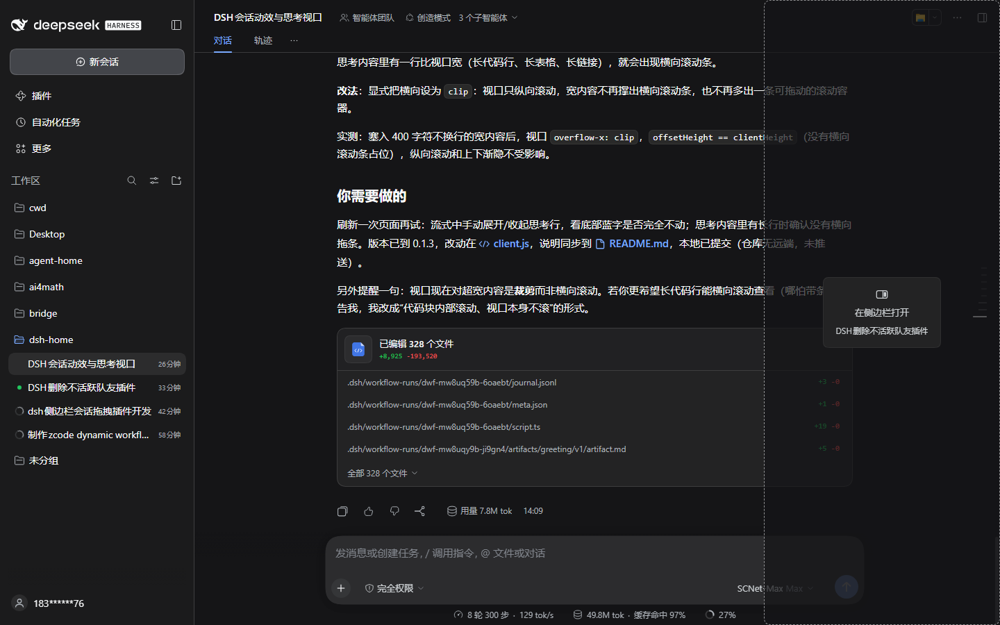
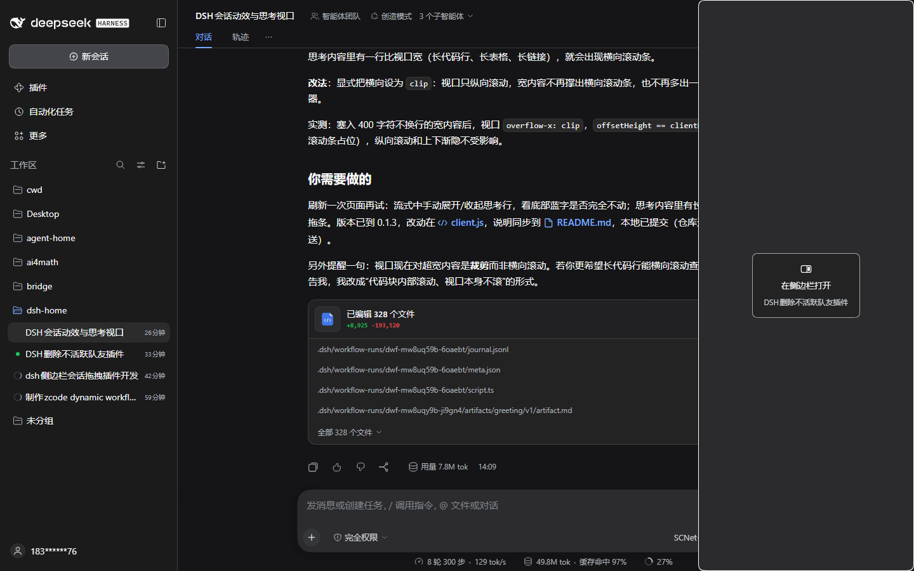
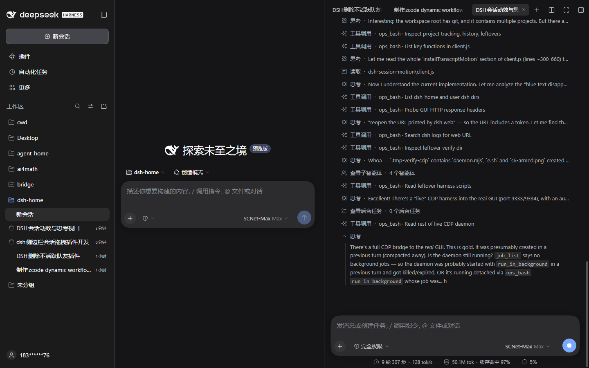
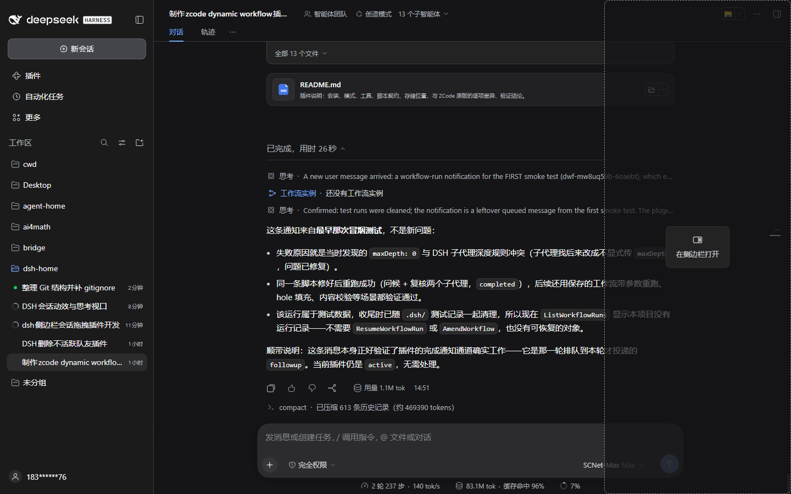

# dsh-session-aside 安装后行为验证

- 验证对象：`dsh-session-aside@0.1.0`（desktop profile 已安装，bundle 行 `session-aside` 运行中）
- 验证时间：2026-11-09 14:10–14:31（Asia/Shanghai）
- 页面：`http://127.0.0.1:12022`（正在运行的 DSH 桌面应用所服务的 GUI；未重启、未关闭、未 kill 该应用）
- 手段：独立 headless Chrome（`--headless=new`，独立 user-data-dir，CDP 端口 9333）＋ 自写的 CDP 驱动；视口 1440×900；通过 `Runtime.evaluate` 做 DOM 断言、点击、合成 `DragEvent`、截图；全程收集 `Runtime.consoleAPICalled` / `Runtime.exceptionThrown`。
- 边界：未调用 `plugin_manager` 任何动作；未修改 `dsh-session-aside/` 下任何文件（运行期 HMR 由 lead 触发）；验证只影响右侧栏与当前页视图状态。

## 结论

| # | 检查项 | 结果 |
| --- | --- | --- |
| 1 | 插件设置页出现该 bundle，title / description / icon 正确 | 通过 |
| 2 | 左栏会话行菜单出现「在侧边栏打开」，当前屏会话不出现 | 通过 |
| 3 | 点击菜单项后右栏展开、新 tab 标题=被点会话、tab 内渲染该会话、主栏不变 | 通过 |
| 4 | 切换主会话时右栏按会话隔离；切回后 tab 恢复且内容不跟随主屏 | 通过（按产品语义） |
| 5 | 会话行可拖拽、拖拽反馈可见、拖到右栏可投放并打开 | 通过（合成 DragEvent，详见限制） |
| 6 | 关闭右栏 / 关闭 tab / 再打开，无白屏、无 session-aside 报错 | 通过（另见两个上游异常） |
| 7 | 禁用插件后两个入口消失、右栏原生功能不受影响 | 通过（lead 复核，见 §7） |

## 逐项证据

### 1. 插件设置页 —— 通过

打开「插件」页后：

- 卡片节点：`li[data-plugin-package="dsh-session-aside"][data-plugin-status="running"]`
- 标题：`会话侧栏`（= `locale/zh.json` 的 `meta.title`）
- 描述：`把任意会话拖到右侧栏，或从会话菜单中打开，在不切换主会话的情况下并排查看。`（= `meta.description`）
- 图标：`img.V7pFBG_packageImage` 的 `src` 为 `data:image/svg+xml;base64,…`，解码后的 SVG 与仓库 `dsh-session-aside/icon.svg` 前缀完全一致；`naturalWidth×naturalHeight = 24×24`，渲染尺寸 36×36。
- 卡片状态带启用开关，默认开启（本次未操作）。

### 2. 会话“...”菜单入口 —— 通过

- 当前屏会话（行 `aria-selected="true"`）的菜单：5 项 —— 置顶会话 / 重命名 / 分叉会话 / 归档会话 / 复制 Session ID，**不含**「在侧边栏打开」。符合产品语义：自己不能和自己并排。
- 非当前屏会话的菜单：6 项，依次为 置顶会话 / 重命名 / 分叉会话 / **在侧边栏打开** / 归档会话 / 复制 Session ID（插件注册 `order: 350`）。
- 两个菜单各自独立渲染于 body 下的 `div[data-slot="sidebar.workspaces.session.menu.item"]` portal。

### 3. 点击「在侧边栏打开」 —— 通过

操作：主栏为会话 A（`session-fe40a08f…`，屏幕标题「DSH会话动效与思考视口」）时，点开会话 B（`session-eb5b9690…`，标题「DSH删除不活跃队友插件」）的菜单项。

- 右栏面板：`[data-sidebar-right-session][data-sidebar-right-open]` 出现，宽度 648px（1440 视口下）。
- tab strip 新 tab 文案 = `DSH删除不活跃队友插件`，与被点行的 `span[class*=title]` 完全一致；`sidebar.right.pane.tab.title` 的自定义标题同样渲染为该文案。
- tab body：`[data-session-aside-tab]` 存在，内部 slot 链为
  `sessionaside.conversation → conversation.session → conversation.view → conversation.chat.flow → conversation.chat.node`
  一次快照计数：`conversation.chat.node` 172 个、`conversation.user.text.node` 1 个、`tool.call.toolview` 101 个，随加载推进至 202–235 个节点；window 内有可用的输入框。
- 内容归属：被嵌入 tab 的首条用户消息与主栏完全不同（主栏首条为另一条消息），节点规模也不同（tab 172+ vs 主栏 118）。
- 主栏不变：另一轮在右栏已展开时打开会话 C（标题「dsh侧边栏会话拖拽插件开发」）前后，主栏 breadcrumb、`aria-selected` 行、`conversation.chat.node` 数、`conversation.user.text.node` 数、首条用户消息文本、`centerCol.innerText.length` **完全相等**（crumb / 118 / 3 / 文本 / 8194）。
  首次从“右栏关闭→打开”时主栏列宽被挤压，`innerText.length` 由 8210 变为 8194（纯文本重排，crumb、选中行、消息节点未变），不属于内容变化。
- 重复打开同一会话：再次点击同一菜单项后 tab 数不变（该标题 tab 始终 1 个），已有 tab 被聚焦，不产生重复。

### 4. 切换主会话时的右栏语义 —— 通过（与产品语义一致）

- 主栏从会话 A 切到会话 D（`session-ab14c129…`）后：`data-sidebar-right-open` 消失、tab strip 为空、`[data-session-aside-tab]` 为 0 —— 右栏布局按会话存储，不跟随主屏。
- 再切回会话 A：右栏重新 `data-sidebar-right-open`，tab「DSH删除不活跃队友插件」恢复，`[data-session-aside-tab]` 内容仍是被嵌入的 B 会话，未漂移成主屏会话。
- 刷新页面后（`Page.navigate` 重载）：右栏仍恢复为 A 会话下的两个 aside tab，说明布局持久化正常。

### 5. 拖拽入口 —— 通过（合成 DragEvent）

会话行本身带 `draggable="true"`，`data-row-key="session:<sessionId>"`。

用 `new DragEvent('dragstart'|'dragenter'|'dragover'|'drop'|'dragend', {bubbles:true, cancelable:true, dataTransfer: new DataTransfer()})` 在页面内派发（`dataTransfer` 写入 `text/plain = sessionId`）：

1. 对**当前屏**会话行派发 `dragstart`：提示层不出现（`data-armed` 缺失、`display:none`）。
2. 对非当前屏会话行派发 `dragstart`：`div[data-session-aside-dropzone][data-armed]` 出现，`display:flex`；右栏关闭时定位为右侧 `x=1100, y=0, 340×900`，右栏已开时覆盖面板（`792,0,648×900`）。内部 `[data-session-aside-dropzone-label]` = 「在侧边栏打开」，`[data-session-aside-dropzone-title]` = 被拖会话标题。新结构 `dropzone > dropcard > (glyph, label, title)` 存在，卡片文案无溢出（label/title `scrollWidth === clientWidth`）。
3. 对提示层派发 `dragenter`/`dragover`：`data-over` 出现、`defaultPrevented=true`；过渡结束后边框由 `dashed / 55% 前景色` 变为 `solid`（`rgb(249,250,251)`，当前主题下 brand-primary 即前景色）、主标签色由 `rgb(207,211,214)` 变为 `rgb(249,250,251)`、卡片边框由 6% 前景色变为 60%。
4. 派发 `drop`：`data-armed`/`data-over` 清除，右栏打开，新 tab 文案 = 被拖会话标题，tab body 渲染该会话（一次计数 481 个对话节点），主栏不变。
5. `dragend` 单独派发可清除 `data-armed`（`display:none`）。
6. HMR 后检查无重复注册：`[data-session-aside-dropzone]` 1 个、`[data-session-aside-dropcard]` 1 个、`style[data-plugin="dsh-session-aside"]` 1 个。

截图（新卡片样式，已随报告保留）：





> 拖拽由合成事件驱动，触发的是页面真实监听器（包括左栏原生 dragstart 与插件的 document 监听）；未走操作系统级指针拖拽链路，因此“拖拽影像/真实 dataTransfer 快照”未覆盖。

### 6. 关闭 / 重开与错误回归 —— 通过（附上游异常）

- 依次关闭 4 个 tab（2 个 aside、文件、终端）后右栏自动关闭：`data-sidebar-right-open` 消失、`[data-session-aside-tab]` 0、主栏 breadcrumb 仍为会话 A、左栏 4 行会话正常、无白屏；该窗口内 console/exception 事件 0。
- 通过菜单多次重开、通过拖拽重开、再关闭，均正常。
- 原生右栏能力（插件启用、且有 aside tab 存在时）实测可打开：
  - 「开始」guide tab（`开始 / 工作区文件 / 新建终端 / 浏览器` 入口）
  - 「文件」tab：渲染工作区文件列表
  - 终端 tab：标题 `cmd.exe`，出现终端画布并启动 shell（未输入任何命令，验证后随 tab 关闭）
- 全程没有出现任何 `session-aside` / `dsh-session-aside` 相关的 console 输出或异常栈帧；也没有插件自身的 `console.warn`。

观察到的两个异常（均不归属于本插件，如实记录）：

1. 首次进入页面时出现一次 `slot entry crashed in 'conversation.input.dock': TypeError: Cannot read properties of null (reading 'text')`，栈在 `@deepseek-ai/dsh-client-ui-chat` 的 `QueueDock`；刷新后重复打开同一会话未再复现，栈内无 session-aside 帧。标记为待观察，不判插件失败。
2. 在右栏「开始」tab 点「工作区文件」时，核心布局抛 `Error: layout: tab <id> has no pane`（dockkit `openContent → seat → advance`）。该问题在**没有任何 session-aside tab**、仅原生「开始」tab（单 pane）时同样复现，属上游右栏布局缺陷，不计入本插件结论。复现路径：右栏「开始」→ 点击「工作区文件」。

### 7. 禁用插件 —— 通过（lead 复核）

`plugin_manager(action="set_plugin", target="include:session-aside", enabled=false)` → `application: applied`，随后用 client `Slots.listSubTree` 复核：

- `sidebar.workspaces.session.menu.item` 的 `open-aside`（order 350）从 occupants 消失，仅剩 pin 100 / rename 200 / fork 300 / archive 400 / session-id 450；
- `sidebar.right.pane.tab` 的 `dsh-session-aside/session` 消失，子槽位 `sessionaside.conversation` 从 children 表中移除；
- 原生 tab 席位全部在：guide、documentpreview、terminal、files、browser、subagent、deliverables、plan、schedule。

`enabled=true` 重启后 `open-aside` 与 `dsh-session-aside/session` 均恢复，`application: applied`，无 warnings。

`target` 的取值注意：`set_plugin` 只认 Loader entry id（本包为 `include:session-aside`），传包名 `dsh-session-aside` 会返回 `unknown-plugin`。

## 附带观察

- 通过菜单先后打开两个不同会话时，右栏以 `preferNewPane: true` 分成两个 pane（1440 视口下各 324px），两个 tab 的 `aria-selected` 均为 true（各自 pane 的活动 tab）；这是并排语义的实现方式，非异常。
- 同一会话重复打开不新增 tab，只聚焦已有 tab。
- 会话行在插件未参与时即 `draggable="true"`，拖拽起点由左栏原生提供。

## 限制

- 拖拽为合成 `DragEvent`，未覆盖系统级拖拽影像与真实 `DataTransfer` 生命周期。
- 会话正文未抄录；文中仅出现会话标题与 DOM 计数。

## 迭代验证：不拆栏 + 放置提示去标题（2026-11-09 15:14–15:25）

验证对象为 `client.js` 15:13 版本（HMR 后页面已加载新代码；独立 headless Chrome + 自写 CDP 驱动，视口 1440×900，方法同前）。本文 §5 与「附带观察」中“`preferNewPane` 拆成两个 pane、各 324px”的描述是本次改动**之前**的旧行为，本节记录改动后的现状。

起始状态刻意保持干净：新开独立 Chrome profile（localStorage 无历史右栏布局），主会话为新建的「新会话」，右栏初始关闭；先打开一个非当前会话的 session-aside 标签作为“已有标签页”，另一轮用原生「开始」tab 作为“已有标签页”，再执行打开/拖入。

| 检查项 | 结果 |
| --- | --- |
| 右栏已有标签时，再打开一个会话：同一 pane、占满栏宽 | 通过 |
| 拖拽落入同一 pane、不拆栏 | 通过 |
| 放置提示卡只有图标 +「在侧边栏打开」，无会话标题 | 通过 |
| 菜单项仅非当前会话出现 | 通过 |
| 同一会话重复打开只聚焦、不新增标签 | 通过 |
| 控制台无 session-aside 相关报错 | 通过（另见上游 `present.open` 500） |

### 1. 不拆栏、标签占满栏宽 —— 通过

测量口径：`panel` 取 `[data-sidebar-right-session][data-sidebar-right-panel][data-sidebar-right-open]`；`paneCount` 取 `panel.querySelectorAll('[data-dockkit-pane]').length`；`strips` 取 `[data-dockkit-strip]` 数量；`grid` 取 `[class*=tabLayout]` 的 `grid-template-columns`；`ratio` 取当前 `[data-session-aside-tab]` 的 `getBoundingClientRect().width / panel.width`。

- **菜单路径**：右栏已有会话 A（`session-eb5b9690…`，标题「DSH删除不活跃队友插件」，ratio 0.998）时，从菜单打开会话 B（`session-4a2b3d20…`，标题「制作zcode dynamic workflow插件移植」）：
  - `paneCount = 1`，`strips = 1`，`paneWidths = [648]`，`panelWidth = 648`；
  - `grid = minmax(0px, 1fr)`（单栏；改动前为 `0.5fr 0px 0.5fr` 双栏）；
  - tab strip：`[DSH删除不活跃队友插件, 制作zcode dynamic workflow插件移植]` 同一条 strip，新 tab 为选中态；
  - 新 tab 内容区宽 647px，`ratio = 0.998 ≥ 0.9`；切回 A 后 A 内容区同样 647px，B 仍可切回。
- **拖拽路径**：右栏已有原生「开始」tab + 会话 B（各占一条 tab），把会话 C（`session-eb5b9690…`）拖入：
  - `paneCount = 1`，`paneWidths = [648]`，`strips = 1`，`grid = minmax(0px, 1fr)`，`ratio = 0.998`；
  - tab strip 变为 `[开始, 制作zcode…, DSH删除不活跃队友插件]`（C 选中），原「开始」tab 仍可切回并渲染 guide 内容，再切回 aside 正常；
  - 全程未出现第二个 pane / 第二条 strip / 0.5fr 双栏网格。



### 2. 放置提示卡只有图标 + 一行文案 —— 通过

对非当前屏会话行派发 `dragstart`（`DataTransfer` 写 `text/plain = sessionId`）后：

- `[data-session-aside-dropcard]` 的 `children.length === 2`；
  - `children[0]`：`SPAN[data-session-aside-dropzone-glyph]`，内含 1 个 `<svg>`；
  - `children[1]`：`SPAN[data-session-aside-dropzone-label]`，文本「在侧边栏打开」。
- `card.textContent === "在侧边栏打开"`；`[data-session-aside-dropzone-title]` 不存在；将页面上 5 个会话标题逐一与卡片文本比对，均不包含。
- 右栏关闭时提示层位于右侧 340×900（`x=1100`），卡片 116×76，居中显示；文案未溢出。



### 3. 回归 —— 通过

- **菜单项只对非当前会话出现**：主屏切为真实会话 `session-fe40a08f…`（「DSH会话动效与思考视口」）后，其菜单 5 项（置顶 / 重命名 / 分叉 / 归档 / 复制 Session ID），不含「在侧边栏打开」；非当前会话菜单 6 项含该项。
  说明：空白草稿行「新会话」本身没有任何行操作按钮（原生行为），不能用它做此项断言，故切换到真实会话复核。
- **重复打开只聚焦**：会话 C 已打开时再次点其菜单项，tab 数保持 3 → 3，C 为选中态，`paneCount` 仍为 1，无重复标签。
- **当前屏会话不可拖**：对当前屏会话行 `dragstart` 后 `data-armed` 仍为 false（本轮再次复现）。
- **控制台**：整轮断言期间未出现任何 `session-aside` / `dsh-session-aside` 栈帧或插件 `console.warn`；`dropzone`/`dropcard`/`style` 各仅 1 份，无 HMR 重复注册。
  观察到一条上游错误：`GET /api/present.open?sessionId=session-4a2b3d20…&seq=1767&index=0` 返回 500。把同一会话切到**主屏**后该 500 同样出现，故属上游 present 资源读取问题，与 session-aside 无关。

### 复现命令

临时驱动（已删除）：`node .tmp-verify-cdp/daemon.mjs` 连接 headless Chrome 的 CDP（9333），监听 `127.0.0.1:9334` 提供 `/eval`、`/shot`、`/logs`；断言表达式与上文测量口径一致，例如：

```js
// 不拆栏/占满栏宽
const p = document.querySelector('[data-sidebar-right-session][data-sidebar-right-panel][data-sidebar-right-open]');
({ paneCount: p.querySelectorAll('[data-dockkit-pane]').length,
   strips: p.querySelectorAll('[data-dockkit-strip]').length,
   grid: p.querySelector('[class*=tabLayout]').getAttribute('style'),
   ratio: p.querySelector('[data-session-aside-tab]').getBoundingClientRect().width
        / p.getBoundingClientRect().width })
```

结论：两处改动均按预期生效，未发现新回归。
